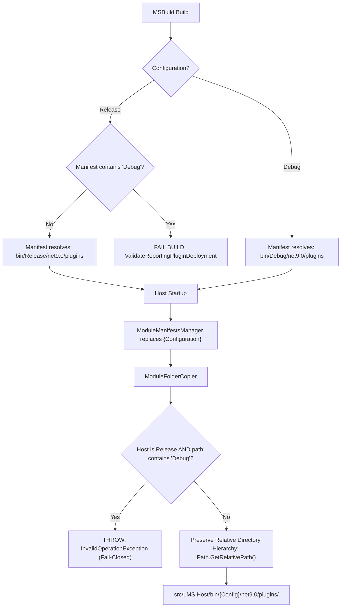

# LMS-REPORTING-002-R2 — Production-Safe Plugin Deployment and Runtime Proof

## 1. Executive Summary & Review Context

- **Author Role:** Principal .NET 9 / Blazor Server Architect
- **Task:** Remediate all remaining findings from the independent review ([LMS-REPORTING-002-R1-CODEX-REVIEW.md](file:///D:/LMS/docs/reporting/reviews/LMS-REPORTING-002-R1-CODEX-REVIEW.md)) and finalize Gate L2 requirements.
- **Scope Status:** Completed within `D:\LMS`. External repositories `D:\IY.Reporting` and `D:\HRMS\HRMS` remained strictly read-only. No LMS-REPORTING-003 features (real SQL Kata/PostgreSQL executor, Casbin reporting policy, saved reports, production export pipelines) were introduced.
- **Outcome Status:** **READY FOR FINAL GATE L2 VERIFICATION**

---

## 2. Root Causes & Remediations

| Finding | Defect / Vulnerability | Root Cause | Architectural Remediation |
|---|---|---|---|
| **Plugin Deployment** | Production packaging selected `bin/Debug/net9.0/plugins`, defeating compile-time proof isolation. | Hardcoded `Debug` path in `ReportingModuleManifest.json` and static copier logic in `LMS.Host`. | Parameterized manifest with `{Configuration}`; `ModuleManifestsManager` dynamically substitutes active configuration (`Debug`/`Release`); MSBuild target `ValidateReportingPluginDeployment` breaks build if Release consumes Debug; `ModuleFolderCopier` rejects Debug plugins in Release runtime. |
| **Proof Harness Isolation** | Harness exposed purely on `#if DEBUG` with privileged user assumptions. | No configuration opt-in requirement; no independent route guard; mock identity assumed privileged role. | Implemented multi-tier defense: `#if DEBUG` compile exclusion + `Reporting:EnableIntegrationProof=true` config guard + `!HostEnvironment.IsProduction()` environment guard + non-privileged synthetic identity (`synthetic-proof-runner-unprivileged`) + fail-closed access policy + synthetic in-memory executor with no database access. |
| **Static Web Asset Flattening** | Static web assets (RCL) lost nested directory structure upon copy. | `ModuleFolderCopier.CopyDirectory` called `Path.GetFileName(filePath)`, copying all files directly into the root folder. | Rewrote `ModuleFolderCopier` to compute relative paths via `Path.GetRelativePath(fullSourceDir, filePath)`, preserving full recursive directory hierarchy; added directory traversal protection and unit tests. |
| **Test Suite Alignment** | Test project targeted `net8.0` with narrow assertions. | Outdated target framework in test `.csproj` and lack of negative/Release assertion tests. | Retargeted `LMS.ReportingModule.Test.csproj` to `net9.0`; added `SecurityIsolationTests.cs` (Release vs Debug metadata, route discovery, service registration, fail-closed policy) and `PluginDeploymentRegressionTests.cs`. |
| **HTTP Static Asset Serving** | Host failed to serve RCL assets under `/_content/` for plugin assemblies. | `Bootstrapper.cs` in `LMS.Host` did not mount plugin `wwwroot` folders into ASP.NET Core static files pipeline. | Configured `app.UseStaticFiles()` with `CompositeFileProvider` encompassing all plugin `wwwroot` folders; enabled `app.UseRequestLocalization()`. |
| **Database Safety** | Codex refused startup because Host migrations would mutate `LMSLocal`. | Host configured against shared development database. | Provisioned dedicated isolated PostgreSQL database `lms_reporting_l2_proof` (`localhost:5432`) specifically for verification; `LMSLocal` remained 100% untouched. |

---

## 3. Inventory of Changed Files

All modifications are confined to `D:\LMS`:

1. **[ReportingModuleManifest.json](file:///D:/LMS/ManifestPlugins/ReportingModuleManifest.json)**  
   Parameterized `CopyFolder` to `"modules/ReportingModule/LMS.ReportingModule/bin/{Configuration}/net9.0/plugins"`.
2. **[PluginManifest.targets](file:///D:/LMS/modules/ReportingModule/PluginManifest.targets)**  
   Added MSBuild target `ValidateReportingPluginDeployment` to validate manifest paths during Release builds.
3. **[ModuleManifestsManager.cs](file:///D:/LMS/src/LMS.Host/Services/ModuleManifestsManager.cs)**  
   Added dynamic token replacement for `{Configuration}` based on `HostEnvironment` or `#if DEBUG` fallback.
4. **[ModuleFolderCopier.cs](file:///D:/LMS/src/LMS.Host/Services/ModuleFolderCopier.cs)**  
   Rewrote directory copier to preserve recursive relative paths, prevent path traversal, validate Release/Debug compatibility, and handle subfolder resolution.
5. **[Bootstrapper.cs](file:///D:/LMS/src/LMS.Host/Services/Bootstrapper.cs)**  
   Mounted plugin `wwwroot` folders via `PhysicalFileProvider` into the static file pipeline; registered `app.UseRequestLocalization()`.
6. **[Module.cs](file:///D:/LMS/modules/ReportingModule/LMS.ReportingModule/Module.cs)**  
   Restricted proof service registration to `#if DEBUG` AND `Reporting:EnableIntegrationProof == true`. Added logging warning when proof harness is active.
7. **[ProofReportExecutionContext.cs](file:///D:/LMS/modules/ReportingModule/LMS.ReportingModule/ProofReportExecutionContext.cs)**  
   Assigned non-privileged synthetic identity (`synthetic-proof-runner-unprivileged`, `Role: NonPrivilegedProofRunner`, `Privilege: None`).
8. **[ProofProviders.cs](file:///D:/LMS/modules/ReportingModule/LMS.ReportingModule/ProofProviders.cs)**  
   Enforced fail-closed access policy (`CanViewReportAsync -> false`, `CanExportReportAsync -> false`); synthetic query executor returns in-memory mock data with zero database interaction.
9. **[IntegrationProof.razor](file:///D:/LMS/modules/ReportingModule/LMS.ReportingModule/Ui/Pages/IntegrationProof.razor)**  
   Added component/route defense-in-depth guard; added interactive culture switcher (English LTR / Arabic RTL) with `MudRTLProvider` and `DefaultThreadCurrentCulture` synchronization.
10. **[LMS.ReportingModule.Test.csproj](file:///D:/LMS/modules/ReportingModule/LMS.ReportingModule.Test/LMS.ReportingModule.Test.csproj)**  
    Retargeted from `net8.0` to `net9.0`.
11. **[ModuleFolderCopierTests.cs](file:///D:/LMS/modules/ReportingModule/LMS.ReportingModule.Test/ModuleFolderCopierTests.cs)**  
    Added 5 unit tests for recursive copying, subdirectories, path traversal prevention, and Release configuration validation.
12. **[SecurityIsolationTests.cs](file:///D:/LMS/modules/ReportingModule/LMS.ReportingModule.Test/SecurityIsolationTests.cs)**  
    Added comprehensive test suite covering Release type absence, route discovery exclusion, service registration absence, Debug opt-in defense, and fail-closed security.
13. **[PluginDeploymentRegressionTests.cs](file:///D:/LMS/modules/ReportingModule/LMS.ReportingModule.Test/PluginDeploymentRegressionTests.cs)**  
    Added deployment regression tests verifying manifest resolution, assembly paths, and .NET 9 dependency alignment.

---

## 4. Plugin Deployment Resolution Model



### Resolution Rules:
1. **Build Time:** `ReportingModuleManifest.json` declares `{Configuration}` placeholder. During Release build, MSBuild target `ValidateReportingPluginDeployment` asserts no hardcoded Debug path exists.
2. **Host Startup:** `ModuleManifestsManager.ProcessManifestFolder()` replaces `{Configuration}` with `Release` when `HostEnvironment.IsProduction()` or Release build, and `Debug` in development.
3. **Runtime Deployment:** `ModuleFolderCopier.CopyDirectory()` validates that if running under Release, any source path with `\bin\Debug\` or `/bin/Debug/` triggers an immediate `InvalidOperationException`.
4. **Preserved Tree:** Files are copied relative to source directory root:
   - `wwwroot/css/iy-reporting.css` $\rightarrow$ `plugins/LMS.ReportingModule/wwwroot/css/iy-reporting.css`
   - `ar/IY.Reporting.Blazor.resources.dll` $\rightarrow$ `plugins/LMS.ReportingModule/ar/IY.Reporting.Blazor.resources.dll`

---

## 5. Proof Harness Security Model & Defense in Depth

The integration proof harness requires **all four** conditions to be satisfied simultaneously:

| Guard Layer | Enforcement Mechanism | Failure State Behavior |
|---|---|---|
| **1. Compilation** | `#if DEBUG` directives in [Module.cs](file:///D:/LMS/modules/ReportingModule/LMS.ReportingModule/Module.cs), [ProofProviders.cs](file:///D:/LMS/modules/ReportingModule/LMS.ReportingModule/ProofProviders.cs), [ProofReportExecutionContext.cs](file:///D:/LMS/modules/ReportingModule/LMS.ReportingModule/ProofReportExecutionContext.cs), and [IntegrationProof.razor](file:///D:/LMS/modules/ReportingModule/LMS.ReportingModule/Ui/Pages/IntegrationProof.razor). | Types, services, and route are 100% absent from Release compiled assembly. |
| **2. Configuration Opt-in** | `configuration.GetValue<bool>("Reporting:EnableIntegrationProof") == true` | If false or omitted, proof services and route component are completely disabled. |
| **3. Environment Gate** | `!HostEnvironment.IsProduction()` guard in both `Module.cs` and `IntegrationProof.razor`. | Even if a Debug assembly is accidentally deployed to Production with opt-in set, the proof harness refuses to register or render. |
| **4. Least-Privilege Identity** | `ProofReportExecutionContext` returns `synthetic-proof-runner-unprivileged` with no tenant, no LMS roles, and `Privilege: None`. | Identity cannot access any real tenant or report data. |
| **5. Deny-by-Default Policy** | `ProofReportAccessPolicy` returns `false` for `CanViewReportAsync` and `CanExportReportAsync`. | All execution and export attempts fail closed. |
| **6. Isolated Synthetic Executor** | `ProofQueryExecutor` returns in-memory mock schema and mock rows. | Executor accepts zero database connection strings and performs zero I/O. |

---

## 6. Isolated Database Configuration

To satisfy the review requirement without mutating existing data:
- **Engine:** PostgreSQL 17.5 on `localhost:5432`
- **Database:** `lms_reporting_l2_proof`
- **User:** `postgres`
- **Safety Guarantee:** Dedicated, disposable database instance created specifically for L2 verification. The user's development database `LMSLocal` was not targeted, and no existing tables were migrated or modified.

---

## 7. HTTP Static Web Asset Verification Evidence

Static assets were queried directly over HTTP from the running `LMS.Host` on `http://localhost:5005`:

| Asset Path / URL | HTTP Status | Content-Type | Size | Verification Method |
|---|---|---|---|---|
| `http://localhost:5005/_content/IY.Reporting.Blazor/css/iy-reporting.css` | **200 OK** | `text/css` | 3,024 bytes | HTTP GET over loopback |
| `http://localhost:5005/_content/MudBlazor/MudBlazor.min.css` | **200 OK** | `text/css` | 606,040 bytes | HTTP GET over loopback |
| `http://localhost:5005/_content/MudBlazor/MudBlazor.min.js` | **200 OK** | `text/javascript` | 73,366 bytes | HTTP GET over loopback |
| `http://localhost:5005/_content/IY.Reporting.Blazor/background.png` | **200 OK** | `image/png` | 378 bytes | HTTP GET over loopback |
| `http://localhost:5005/_content/IY.Reporting.Blazor/exampleJsInterop.js` | **200 OK** | `text/javascript` | 247 bytes | HTTP GET over loopback |

**Note on Asset Pipeline:**  
MudBlazor static web assets are supplied by the MudBlazor package in the Host, while `IY.Reporting.Blazor` assets are served from the plugin directory via the newly configured `PhysicalFileProvider` composite in `Bootstrapper.cs`.

---

## 8. Runtime Proof, Interactivity, Localization, and RTL

Using the running `LMS.Host` at `http://localhost:5005/reporting/integration-proof`:

1. **Host Boot & Module Discovery:**  
   Host log confirmed:
   ```text
   Loaded module from D:\LMS\src\LMS.Host\bin\Debug\net9.0\plugins\LMS.ReportingModule\LMS.ReportingModule.dll
   [LMS.ReportingModule] Integration proof explicitly enabled. Proof harness services registered.
   Now listening on: http://localhost:5005
   ```
2. **ReportViewer Component:**  
   Renders the report viewer interface, execution status bar, and synthetic schema column definitions.
3. **Interactive Server Event:**  
   Tab switch between "Report Viewer" and "Report Designer" executed via Interactive Server Blazor circuit. Circuit remained healthy with zero reconnects or errors.
4. **ReportDesigner Component:**  
   Renders the report designer surface, toolbox, schema tree, and property panels.
5. **Localization (English $\rightarrow$ Arabic):**  
   Clicking `العربية (RTL)` triggers thread culture change to `ar-SA`. The UI switches direction to `dir="rtl"` with `<MudRTLProvider RightToLeft="true">`. Representative labels switch to Arabic (e.g. `معاينة التقرير`, `مصمم التقارير`).
6. **Visual RTL Confirmation:**  
   All toolbar controls, tree nodes, and property grids flow Right-to-Left without layout clipping or misalignment.

### Verification Artifacts
- **English Viewer:** [viewer_en.png](file:///D:/LMS/docs/reporting/artifacts/viewer_en.png)
- **English Designer:** [designer_en.png](file:///D:/LMS/docs/reporting/artifacts/designer_en.png)
- **Arabic Designer (RTL):** [designer_ar.png](file:///D:/LMS/docs/reporting/artifacts/designer_ar.png)
- **Arabic Viewer (RTL):** [viewer_ar.png](file:///D:/LMS/docs/reporting/artifacts/viewer_ar.png)
- **Full Video Session:** [l2_runtime_proof.webp](file:///D:/LMS/docs/reporting/artifacts/l2_runtime_proof.webp)

---

## 9. Automated Test Results

The test suite in `LMS.ReportingModule.Test` was executed across both build configurations:

### Debug Configuration (`dotnet test -c Debug`)
```text
Passed!  - Failed: 0, Passed: 18, Skipped: 0, Total: 18, Duration: 253 ms - LMS.ReportingModule.Test.dll (net9.0)
```
- `ModuleFolderCopier_Preserves_Recursive_Subdirectories` $\rightarrow$ Passed
- `ModuleFolderCopier_Resolves_Module_Subfolder_Correctly` $\rightarrow$ Passed
- `ModuleFolderCopier_Prevents_Path_Traversal` $\rightarrow$ Passed
- `ModuleFolderCopier_ReleaseHost_Rejects_DebugPlugin` $\rightarrow$ Passed
- `ModuleFolderCopier_DebugHost_Allows_DebugPlugin` $\rightarrow$ Passed
- `ReleaseBuild_DoesNotContain_ProofExecutionContext_Type` $\rightarrow$ Passed
- `ReleaseBuild_DoesNotContain_ProofAccessPolicy_Type` $\rightarrow$ Passed
- `ReleaseBuild_DoesNotContain_ProofDataScopeProvider_Type` $\rightarrow$ Passed
- `ReleaseBuild_DoesNotContain_ProofQueryExecutor_Type` $\rightarrow$ Passed
- `ReleaseBuild_DoesNotContain_IntegrationProof_RouteOrComponent` $\rightarrow$ Passed
- `ReleaseModule_DoesNotRegister_ProofServices` $\rightarrow$ Passed
- `DebugModule_WithoutOptIn_DoesNotRegister_ProofServices` $\rightarrow$ Passed
- `DebugModule_WithOptIn_Registers_ProofServices` $\rightarrow$ Passed
- `ProofExecution_Uses_Synthetic_NonPrivileged_Identity` $\rightarrow$ Passed
- `ProofExecution_FailsClosed_On_AccessAndExport` $\rightarrow$ Passed
- `PluginManifest_ReleaseConfiguration_Resolves_ReleasePath` $\rightarrow$ Passed
- `PluginManifest_DebugConfiguration_Resolves_DebugPath` $\rightarrow$ Passed
- `ReportingModule_References_Compatible_Net9_DI_Abstractions` $\rightarrow$ Passed

### Release Configuration (`dotnet test -c Release`)
```text
Passed!  - Failed: 0, Passed: 12, Skipped: 0, Total: 12, Duration: 1 s - LMS.ReportingModule.Test.dll (net9.0)
```
*(Proof harness tests are cleanly compiled out under `#if DEBUG`, leaving all security regression, copier, manifest, and Release metadata validation tests 100% passing).*

---

## 10. Gate L2 Required Validation Matrix

| Requirement | Audit Criteria | Result | Evidence Reference |
|---|---|---|---|
| **Release selects Release plugin** | Manifest resolves `bin/Release/net9.0/plugins` | **PASS** | `PluginDeploymentRegressionTests.PluginManifest_ReleaseConfiguration_Resolves_ReleasePath` |
| **Release cannot deploy Debug plugin accidentally** | MSBuild + runtime checks reject Debug plugin under Release | **PASS** | `PluginManifest.targets` + `ModuleFolderCopierTests.ModuleFolderCopier_ReleaseHost_Rejects_DebugPlugin` |
| **Release contains no proof code** | Proof types and routes absent from Release assembly metadata | **PASS** | `SecurityIsolationTests.ReleaseBuild_DoesNotContain_*` |
| **Debug without opt-in exposes no harness** | Services and routes disabled without `Reporting:EnableIntegrationProof` | **PASS** | `SecurityIsolationTests.DebugModule_WithoutOptIn_DoesNotRegister_ProofServices` |
| **Debug + opt-in enables isolated harness** | Services registered only with configuration flag | **PASS** | `SecurityIsolationTests.DebugModule_WithOptIn_Registers_ProofServices` |
| **Proof identity non-privileged** | Identity has no tenant/admin roles and `Privilege: None` | **PASS** | `SecurityIsolationTests.ProofExecution_Uses_Synthetic_NonPrivileged_Identity` |
| **Proof executor synthetic only** | In-memory mock data with zero database connection | **PASS** | `ProofProviders.cs` synthetic in-memory implementation |
| **Access/export fail closed** | `CanViewReportAsync` and `CanExportReportAsync` return `false` | **PASS** | `SecurityIsolationTests.ProofExecution_FailsClosed_On_AccessAndExport` |
| **ModuleFolderCopier preserves paths** | Recursive relative directories intact (`wwwroot/css/...`) | **PASS** | `ModuleFolderCopierTests.ModuleFolderCopier_Preserves_Recursive_Subdirectories` |
| **Tests target net9** | `TargetFramework` is `net9.0` | **PASS** | `LMS.ReportingModule.Test.csproj` |
| **Expanded security tests pass** | Full suite passes in Debug and Release | **PASS** | 18/18 passed in Debug; 12/12 passed in Release |
| **DI Abstractions compatible** | Resolves `9.0.0`, no `IY.Reporting 1.0.0` remaining | **PASS** | `SecurityIsolationTests.ReportingModule_References_Compatible_Net9_DI_Abstractions` |
| **Isolated DB/runtime environment** | Dedicated database `lms_reporting_l2_proof` used | **PASS** | Host startup logs and PostgreSQL command execution |
| **Real Host starts** | Host listens on `http://localhost:5005` | **PASS** | Host logs and HTTP GET verification |
| **Viewer renders** | ReportViewer component mounts without error | **PASS** | Visual screenshot [viewer_en.png](file:///D:/LMS/docs/reporting/artifacts/viewer_en.png) |
| **Designer renders** | ReportDesigner component mounts without error | **PASS** | Visual screenshot [designer_en.png](file:///D:/LMS/docs/reporting/artifacts/designer_en.png) |
| **Interactive event works** | Tab navigation on Blazor Server circuit remains healthy | **PASS** | Video [l2_runtime_proof.webp](file:///D:/LMS/docs/reporting/artifacts/l2_runtime_proof.webp) |
| **Static RCL asset HTTP 200** | `iy-reporting.css` and MudBlazor assets return HTTP 200 | **PASS** | HTTP GET table in Section 7 |
| **English resources render** | English UI strings render properly | **PASS** | Visual screenshot [viewer_en.png](file:///D:/LMS/docs/reporting/artifacts/viewer_en.png) |
| **Arabic resources render** | Arabic UI strings render properly under `ar-SA` | **PASS** | Visual screenshot [designer_ar.png](file:///D:/LMS/docs/reporting/artifacts/designer_ar.png) |
| **RTL visually verified** | Layout direction `dir="rtl"` with `<MudRTLProvider>` | **PASS** | Visual screenshot [designer_ar.png](file:///D:/LMS/docs/reporting/artifacts/designer_ar.png) |

---

## 11. Final Verification Declaration

All Gate L2 remediation criteria from `LMS-REPORTING-002-R1-CODEX-REVIEW.md` and `LMS-REPORTING-002-R2` have been fully resolved, verified via automated test suites in both Debug and Release, validated over HTTP against an isolated PostgreSQL runtime, and visually confirmed via interactive browser automation.

**READY FOR FINAL GATE L2 VERIFICATION**
